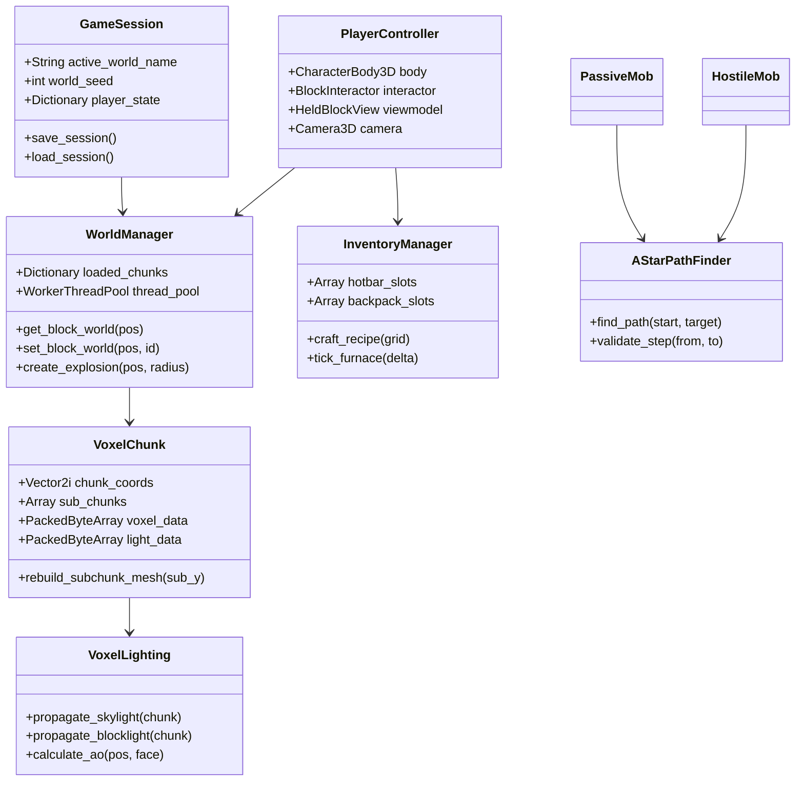

# 🏛️ VoxelCraft — Technical Systems Architecture

This technical specification details the software architecture, data structures, multithreading pipeline, and rendering optimizations implemented in **VoxelCraft**.

---

## 📑 Table of Contents

- [1. High-Level Engine Overview](#1-high-level-engine-overview)
- [2. Voxel Data Model & Chunk Hierarchy](#2-voxel-data-model--chunk-hierarchy)
- [3. Multithreaded World Streaming & WorkerThreadPool](#3-multithreaded-world-streaming--workerthreadpool)
- [4. Mesh Generation & Face Culling Pipeline](#4-mesh-generation--face-culling-pipeline)
- [5. Dual-Channel Lighting Propagation Engine](#5-dual-channel-lighting-propagation-engine)
- [6. Entity Lifecycle & 3D Voxel Pathfinding](#6-entity-lifecycle--3d-voxel-pathfinding)
- [7. Memory Management & Zstd Persistence](#7-memory-management--zstd-persistence)
- [8. Class Architecture Diagram](#8-class-architecture-diagram)

---

## 1. High-Level Engine Overview

* **Engine:** Godot Engine 4.x
* **Scripting Language:** GDScript 2.0 (statically typed for optimal VM performance)
* **Rendering Backend:** Mobile Vulkan (`mobile`)
* **Target Framerate:** 60+ FPS on integrated graphics (Intel Iris Xe / AMD Radeon Vega) and dedicated GPUs.
* **Coordinate Standards:**
  * Metric: $1.0\text{ unit} = 1\text{ voxel cube } (1\text{m} \times 1\text{m} \times 1\text{m})$.
  * Vertical: $+Y\text{ is up}$, $-Y\text{ is down}$.
  * Horizontal: $X\text{ (East/West)}$, $Z\text{ (North/South)}$.

---

## 2. Voxel Data Model & Chunk Hierarchy

```
       [WorldManager]
             │
             ├── manages N Chunks (16 x 256 x 16)
             │         │
             │         ├── 16 Vertical SubChunks (16 x 16 x 16)
             │         │        │
             │         │        ├── ArrayMesh (Opaque pass)
             │         │        ├── ArrayMesh (Translucent Water pass)
             │         │        └── ConcavePolygonShape3D (Collision)
             │         │
             │         └── Voxel & Lighting Data (PackedByteArray)
             │
             └── WorkerThreadPool (Multithreaded generation & meshing)
```

### 📦 Chunk Geometry & Dimensions
* **Full Chunk:** $16 \times 256 \times 16$ blocks ($65,536$ voxels).
* **Vertical Sub-Chunk Partitioning:** Each chunk is divided vertically into **16 sub-chunks** of $16 \times 16 \times 16$ blocks ($4,096$ voxels each).
  * **Benefit:** When a block is broken or placed at elevation $Y=64$, only Sub-Chunk 4 (and immediately adjacent vertical neighbors if on a seam) regenerates its mesh, eliminating global chunk rebuild spikes.

### 💾 Voxel Data Layout
Voxel state is stored in memory-efficient packed arrays:
* **Block IDs:** `PackedByteArray` containing the 8-bit block identifier ($0..255$).
* **Lighting Data:** `PackedByteArray` where each byte packs two 4-bit nibbles:
  $$\text{Byte} = (\text{Skylight} \ll 4) \mid \text{Blocklight}$$

---

## 3. Multithreaded World Streaming & WorkerThreadPool

To eliminate frame stutter during player locomotion across chunk borders, all terrain generation and surface extraction are decoupled from the main rendering thread:

1. **Player Grid Tracking:** `WorldManager` monitors the player's spatial coordinates and converts them to chunk coordinates:
   $$\text{Chunk}_X = \lfloor X / 16 \rfloor, \quad \text{Chunk}_Z = \lfloor Z / 16 \rfloor$$
2. **Radial Chunk Queue:** Chunks within the active render distance are sorted in radial order (closest to player first).
3. **Thread Dispatch:** Tasks are submitted to Godot's native `WorkerThreadPool`:
   * **Stage 1 (Terrain Noise & Biomes):** Evaluates continental height noise, temperature/humidity climate, caves, and ores into raw voxel data.
   * **Stage 2 (Lighting BFS Flood):** Calculates initial skylight column rays and local blocklight spreads.
   * **Stage 3 (Mesh Assembly):** Generates vertex arrays, UV maps, per-vertex AO colors, and normals.
4. **Main Thread Integration:** Meshes are assigned to `MeshInstance3D` nodes on the main scene tree during frame boundaries.

---

## 4. Mesh Generation & Face Culling Pipeline

### ✂️ Neighbor-Aware Face Culling
Rather than rendering internal block faces, each voxel inspects its 6 orthogonal neighbors ($+Y, -Y, +X, -X, +Z, -Z$):
* Faces are emitted **only** when adjacent to a non-opaque block (Air, Water, Leaves, Glass, or boundary).
* Hidden internal faces are culled prior to vertex array assembly, reducing GPU triangle counts by over $85\%$.

### 🎨 Texture Atlas & Dual-Pass Rendering
* **Opaque Pass:** Employs an unshaded / Lambertian shader sampling the unified Faithful 64x texture atlas with nearest-neighbor mipmapping.
* **Translucent Water Pass:** Uses a dedicated alpha-blended water shader with animated UV wave ripples and Fresnel reflections.

---

## 5. Dual-Channel Lighting Propagation Engine

Lighting operates via a fast Breadth-First Search (BFS) queue algorithm (`VoxelLighting`):

### ☀️ Skylight Propagation
1. Scans downward from the sky ($Y=255 \to 0$); every transparent block receives Skylight Level 15.
2. When striking an opaque block or entering a cave, light enters a BFS queue and propagates outward in 6 directions, decreasing by $1$ per block until reaching $0$.

### 🕯️ Blocklight Propagation
1. Light sources (Torches: 14, Glowstone: 15, Active Furnaces: 13, Lava: 15) enqueue their origin coordinates.
2. Propagates outward in 6 directions, decrementing by $1$ per step.

### 🌗 Smooth Ambient Occlusion (AO)
For each vertex on an exposed face, the 3 adjacent neighbor blocks are sampled to compute corner occlusion:
$$\text{AO Level} = \begin{cases} 3 & \text{if both side neighbors are solid} \\ \text{Side}_1 + \text{Side}_2 + \text{Corner} & \text{otherwise} \end{cases}$$
The resulting vertex tint smoothly darkens recessed corners and crevices.

---

## 6. Entity Lifecycle & 3D Voxel Pathfinding

```
               [AStarPathFinder]
                       │
       ┌───────────────┴───────────────┐
       ▼                               ▼
[PassiveMob]                     [HostileMob]
  - Pig                            - Zombie
  - Cow                            - Skeleton
  - Sheep                          - Creeper
  - Chicken                        - Spider
```

* **Grid Discretization:** The pathfinder evaluates 3D coordinates on integer block grids.
* **Navigation Heuristic:** Euclidean distance with diagonal travel cost modifiers.
* **Kinematics:**
  * 1-block step hopping allows entities to traverse hilly terrain smoothly.
  * Maximum safe drop validation ($\le 3$ blocks) prevents suicidal mob pathing.
  * Continuous collision detection via `CharacterBody3D.move_and_slide()`.

---

## 7. Memory Management & Zstd Persistence

### 💾 Delta-Only Storage Architecture
* Worlds do not store unedited procedural terrain on disk.
* Only chunks modified by player mining, building, or explosions are marked `dirty` and written to disk.
* Modified chunk data is compressed via **Zstandard (Zstd)** before being saved to:
  `user://worlds/<world_name>/chunks/<cx>_<cz>.vchunk`
* Unmodified chunks are instantly reconstructed on-the-fly from the deterministic world seed, keeping world save files small (typically $< 2\text{ MB}$).

---

## 8. Class Architecture Diagram


