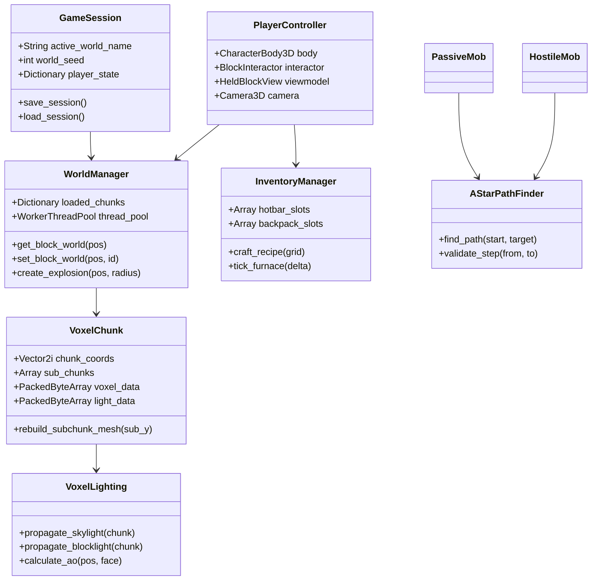

# 🏛️ VoxelCraft — Technical Systems Architecture

This technical specification details the software architecture, data structures, multithreading pipeline, and rendering optimizations implemented in **VoxelCraft**.

---

## 📑 Table of Contents

- [1. High-Level Engine Overview](#1-high-level-engine-overview)
- [2. Voxel Data Model & Chunk Hierarchy](#2-voxel-data-model--chunk-hierarchy)
- [3. Multithreaded World Streaming & WorkerThreadPool](#3-multithreaded-world-streaming--workerthreadpool)
- [4. Mesh Generation & Face Culling Pipeline](#4-mesh-generation--face-culling-pipeline)
- [5. Dual-Channel Lighting Propagation Engine](#5-dual-channel-lighting-propagation-engine)
- [6. Entity Lifecycle & 3D Voxel Pathfinding](#6-entity-lifecycle--3d-voxel-pathfinding)
- [7. Memory Management & Zstd Persistence](#7-memory-management--zstd-persistence)
- [8. Class Architecture Diagram](#8-class-architecture-diagram)

---

## 1. High-Level Engine Overview

* **Engine:** Godot Engine 4.x
* **Scripting Language:** GDScript 2.0 (statically typed for optimal VM performance)
* **Rendering Backend:** Compatibility (OpenGL 3.3, `gl_compatibility`) — runs on old and low-end GPUs.
* **Physics:** Jolt Physics (built into Godot 4.4+).
* **Target Framerate:** 60+ FPS on low-end integrated graphics. Terrain is unshaded with baked lighting, and an automatic render scale (`scripts/core/video_settings.gd`) lowers the 3D resolution only if the GPU still cannot keep up.
* **Benchmark:** `tools/benchmark_render.gd` (run with a window) reports frame times, draw calls and chunk build costs.
* **Coordinate Standards:**
  * Metric: $1.0\text{ unit} = 1\text{ voxel cube } (1\text{m} \times 1\text{m} \times 1\text{m})$.
  * Vertical: $+Y\text{ is up}$, $-Y\text{ is down}$.
  * Horizontal: $X\text{ (East/West)}$, $Z\text{ (North/South)}$.

---

## 2. Voxel Data Model & Chunk Hierarchy

```
       [WorldManager]
             │
             ├── manages N Chunks (16 x 256 x 16)
             │         │
             │         ├── 16 Vertical SubChunks (16 x 16 x 16)
             │         │        │
             │         │        ├── ArrayMesh (Opaque pass)
             │         │        ├── ArrayMesh (Translucent Water pass)
             │         │        └── ConcavePolygonShape3D (Collision)
             │         │
             │         └── Voxel & Lighting Data (PackedByteArray)
             │
             └── WorkerThreadPool (Multithreaded generation & meshing)
```

### 📦 Chunk Geometry & Dimensions
* **Full Chunk:** $16 \times 256 \times 16$ blocks ($65,536$ voxels).
* **Vertical Sub-Chunk Partitioning:** Each chunk is divided vertically into **16 sub-chunks** of $16 \times 16 \times 16$ blocks ($4,096$ voxels each).
  * **Benefit:** When a block is broken or placed at elevation $Y=64$, only Sub-Chunk 4 (and immediately adjacent vertical neighbors if on a seam) regenerates its mesh, eliminating global chunk rebuild spikes.

### 💾 Voxel Data Layout
Voxel state is stored in memory-efficient packed arrays:
* **Block IDs:** `PackedByteArray` containing the 8-bit block identifier ($0..255$).
* **Lighting Data:** `PackedByteArray` where each byte packs two 4-bit nibbles:
  $$\text{Byte} = (\text{Skylight} \ll 4) \mid \text{Blocklight}$$

---

## 3. Multithreaded World Streaming & WorkerThreadPool

To eliminate frame stutter during player locomotion across chunk borders, all terrain generation and surface extraction are decoupled from the main rendering thread:

1. **Player Grid Tracking:** `WorldManager` monitors the player's spatial coordinates and converts them to chunk coordinates:
   $$\text{Chunk}_X = \lfloor X / 16 \rfloor, \quad \text{Chunk}_Z = \lfloor Z / 16 \rfloor$$
2. **Radial Queues:** Chunks are processed closest-first.
3. **Two-stage worker pipeline** (`WorkerThreadPool`, leaving one CPU core for the main thread):
   * **Generate (radius = render distance + 1):** terrain noise, biomes (computed once per column), caves, ores, structures, then the chunk's own lighting. The chunk exists as data only.
   * **Mesh (radius = render distance):** starts once all 8 neighbors have data. Pulls light in across the borders from the neighbors, then meshes every non-empty sub-chunk from an 18³ padded copy, so faces, light and AO are seamless across chunk borders.
4. **Main thread integration (time-budgeted):** finished chunks are attached a few per frame. Collision shapes are only attached within 3 chunks of the player, spread across frames; mobs standing on ground without collision hold still until it arrives.
5. **Edits:** a block change relights its 3×3 chunk neighborhood incrementally, then the affected sub-chunks are re-meshed on workers from small y-slices of the neighborhood (stale results are discarded by version counters).

---

## 4. Mesh Generation & Face Culling Pipeline

The mesher (`scripts/voxel/chunk_mesher.gd`) writes geometry straight into packed arrays (no `SurfaceTool`).

### ✂️ Neighbor-Aware Face Culling
* Buried blocks are rejected with six table lookups before any other work.
* A face is emitted only when the neighbor does not hide it (opaque cubes and the opaque-textured leaves hide faces; glass-like blocks such as ice and lava hide faces only against the same block).
* Render types: full cubes, cutout cubes, cross plants (flowers, sugar cane, saplings), `#`-shaped crops, sloped water, and box shapes (stairs, slabs, doors, cactus, beds, torches...). Box shapes come from `BlockRegistry.get_shape_boxes`, which collision and the selection outline also use.

### 🎨 Vertex Format & Shaders
* **Per vertex:** position, UV (0..1 inside the tile), `UV2` = smooth sky/block light, `COLOR.rgb` = face shade × AO (× wool tint), `COLOR.a` = texture layer.
* **Opaque and cutout passes** (`shaders/voxel_terrain*.gdshader`) are unshaded: one texture fetch from a mip-mapped `Texture2DArray` (one layer per tile, so no bleeding) and the classic light curve. Day and night only change two shader globals (`vc_sky_darken`, `vc_sky_tint`).
* **Water** (`shaders/water.gdshader`) is unshaded and alpha-blended, lit by the same baked light, with scrolling wave normals for the Fresnel tint.

---

## 5. Dual-Channel Lighting Propagation Engine

Lighting operates via a fast Breadth-First Search (BFS) queue algorithm (`VoxelLighting`):

### ☀️ Skylight Propagation
1. Each column is lit straight down at level 15 until a block absorbs it (water and ice remove 2, leaves 1, opaque blocks all of it).
2. Light then spreads sideways into shaded columns (under overhangs, into cave mouths), losing 1 per block.

### 🕯️ Blocklight Propagation
1. Emitters (Torch 14, Glowstone 15, Lava 15, Redstone Torch 7) are found with `PackedByteArray.find` and flood outward, losing 1 per block.

### 🔁 Borders and Edits
* At mesh time a chunk pulls light in across its four borders from the already-lit neighbors.
* Placing or breaking a block runs a removal flood and a re-add flood over the 3×3 chunk buffers around it (light never travels further than 15 blocks), updating only the channels the change can affect. Daylight dropping straight down at level 15 is handled specially, so digging a shaft lights it all the way down.

### 🌗 Smooth Lighting & Ambient Occlusion
Each face vertex averages the light of the cell in front of the face and its (non-opaque) side and corner neighbors, and darkens by the number of occluding neighbors (0–3 → 100/80/65/50%). Quads are triangulated along the brighter diagonal to avoid AO seams. At night the shader subtracts up to 11 levels from skylight, while torch light stays warm.

---

## 6. Entity Lifecycle & 3D Voxel Pathfinding

```
               [AStarPathFinder]
                       │
       ┌───────────────┴───────────────┐
       ▼                               ▼
[PassiveMob]                     [HostileMob]
  - Pig                            - Zombie
  - Cow                            - Skeleton
  - Sheep                          - Creeper
  - Chicken                        - Spider
```

* **Grid Discretization:** The pathfinder evaluates 3D coordinates on integer block grids.
* **Navigation Heuristic:** Euclidean distance with diagonal travel cost modifiers.
* **Kinematics:**
  * 1-block step hopping allows entities to traverse hilly terrain smoothly.
  * Maximum safe drop validation ($\le 3$ blocks) prevents suicidal mob pathing.
  * Continuous collision detection via `CharacterBody3D.move_and_slide()`.

---

## 7. Memory Management & Zstd Persistence

### 💾 Delta-Only Storage Architecture
* Worlds do not store unedited procedural terrain on disk.
* Only chunks modified by player mining, building, or explosions are marked `dirty` and written to disk.
* Modified chunk data is compressed via **Zstandard (Zstd)** before being saved to:
  `user://worlds/<world_name>/chunks/<cx>_<cz>.vchunk`
* Unmodified chunks are instantly reconstructed on-the-fly from the deterministic world seed, keeping world save files small (typically $< 2\text{ MB}$).

---

## 8. Class Architecture Diagram


